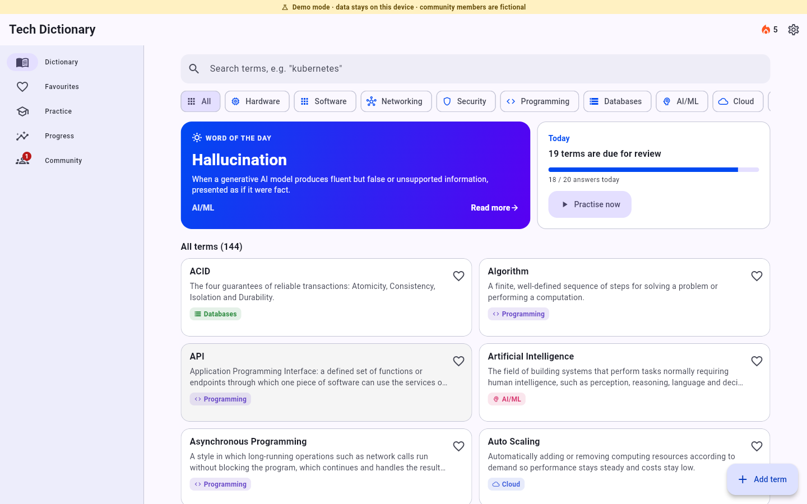
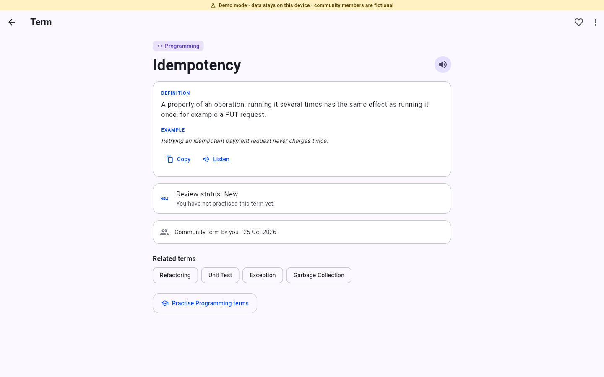
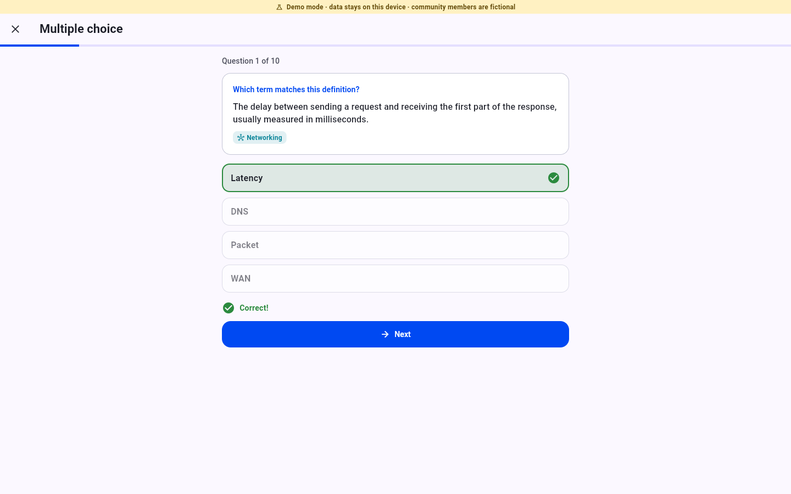
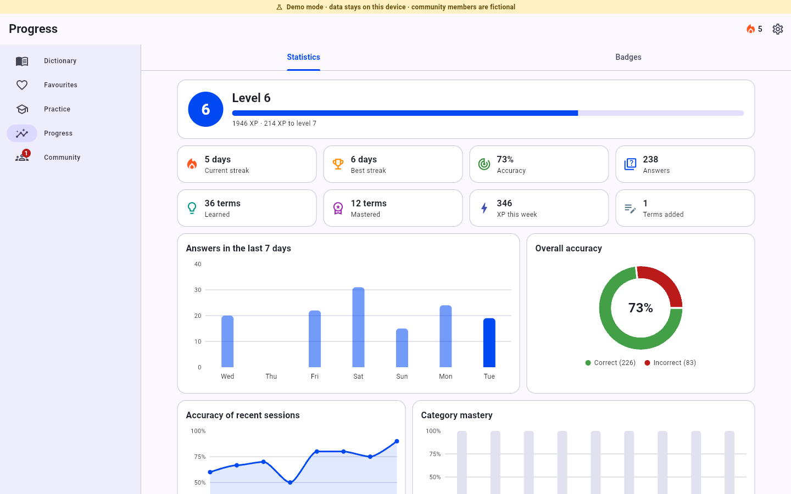
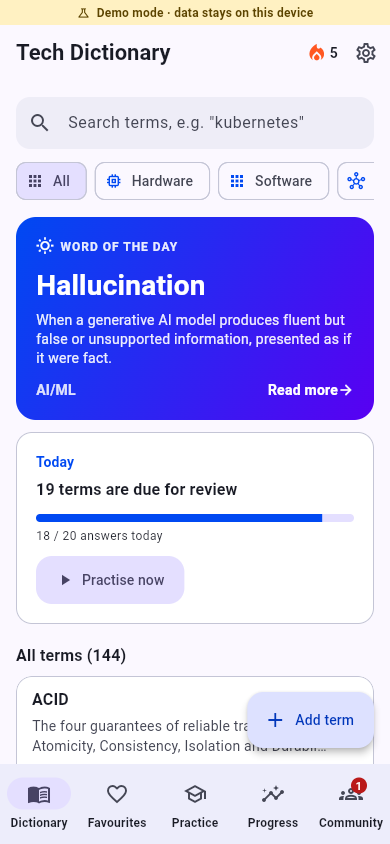

# Tech Dictionary

A Flutter app for learning IT and computing terms. Browse a built-in dictionary of 140 clearly explained terms, practise with three quiz modes that use spaced repetition, earn XP, badges and streaks, and add your own terms.

**Live demo:** https://vaas125.github.io/tech-dictionary/ (runs entirely in the browser, no sign-in or Firebase needed)



| Term detail | Practice | Statistics |
| --- | --- | --- |
|  |  |  |



## Features

**Dictionary**
- 140 built-in terms in 9 categories: Hardware, Software, Networking, Security, Programming, Databases, AI/ML, Cloud and Web
- Search that tolerates typos ("kubernets" finds Kubernetes), category filter, word of the day
- Term detail with text-to-speech (uses the speech engine of the browser or device), copy, related terms and your review status
- Add, edit and delete your own terms; favourites; export to PDF, CSV or Markdown

**Practice**
- Three modes: multiple choice, flashcards and typing (typed answers ignore case and punctuation and forgive one typo in longer terms)
- Spaced repetition with a small SM-2 implementation: every answer schedules the next review, and sessions start with the terms that are due
- Daily goal, per-term review status and a session summary with the terms you missed

**Progress and community**
- XP and levels, daily streaks, 13 badges with progress bars
- Statistics drawn with `fl_chart`: answers per day, overall accuracy, accuracy of recent sessions, mastery per category
- Weekly and all-time ranking
- Suggest a correction to another member's term; authors accept or reject suggestions

**App**
- Material 3, light and dark theme, onboarding, loading/empty/error states
- Responsive layouts: bottom navigation on phones, navigation rail on tablets and desktop
- Semantic labels for screen readers

## Two modes

| | Firebase mode (default) | Demo mode |
| --- | --- | --- |
| Start | `flutter run` | `flutter run --dart-define=DEMO_MODE=true` |
| Sign-in | Email/password and Google (Firebase Auth) | Guest, no network |
| Data | Cloud Firestore | `shared_preferences` on the device |
| Community | Real users | Seeded, fictional members and a sample learning history |
| Banner | none | "Demo mode" banner on every screen |

Both modes run the same screens and logic. Only the repositories behind four interfaces differ (see below). Demo mode never calls `Firebase.initializeApp`.

## Running it

Requires [Flutter](https://docs.flutter.dev/get-started/install) with Dart 3.9.2 or newer. Developed and tested with Flutter 3.47 (Dart 3.13).

```bash
flutter pub get

# Try it without any setup
flutter run -d chrome --dart-define=DEMO_MODE=true

# Tests and static analysis
flutter analyze
flutter test
```

### Firebase mode

Credentials are intentionally not committed: `lib/firebase_options.dart` contains placeholders (`YOUR_FIREBASE_API_KEY`, ...). Without a real configuration the app shows a setup screen instead of starting.

1. Create a Firebase project and enable **Authentication** (Email/Password and Google) and **Cloud Firestore**.
2. Generate your configuration, which overwrites `lib/firebase_options.dart`:

   ```bash
   dart pub global activate flutterfire_cli
   flutterfire configure
   ```

3. Deploy the security rules in [`firestore.rules`](firestore.rules):

   ```bash
   firebase deploy --only firestore:rules
   ```

4. `flutter run`

Firestore layout used by the app:

| Path | Content |
| --- | --- |
| `words/{id}` | Community terms (author can edit/delete, everyone signed in can read) |
| `users/{uid}/private/progress` | The user's learning progress as one JSON document |
| `rankings/{uid}` | The user's leaderboard row |
| `corrections/{id}` | Correction suggestions (visible to proposer and author) |

The Firebase repositories compile and are analysed together with the rest of the code, but the automated tests use the local repositories; they have not been run against a live Firebase project.

### Building the demo for GitHub Pages

The demo is committed to `docs/` and served by GitHub Pages (branch `main`, folder `/docs`). To rebuild it:

```powershell
./scripts/build_demo.ps1                    # base href /tech-dictionary/
./scripts/build_demo.ps1 -BaseHref /my-fork/
```

The script runs `flutter build web --release --dart-define=DEMO_MODE=true --base-href ...`, replaces the contents of `docs/` and adds `.nojekyll`. Roboto is bundled with the app, and Flutter's web renderer is served from `docs/canvaskit`, so the demo makes no requests to third-party hosts.

## Architecture

Provider for state, with a thin layer of plain Dart classes for the logic so it can be unit-tested without a UI.

```
lib/
  main.dart               Chooses demo or Firebase mode and starts the app
  app/                    Root widget, app-level wiring (AppDependencies)
  config/                 Compile-time configuration (DEMO_MODE)
  models/                 Word, CardState (SM-2), UserProgress, QuizResult, ranking, corrections
  data/                   Built-in dictionary, demo seed data, key-value store
  repositories/           Interfaces + local (demo) and Firebase implementations
  services/               Spaced repetition, quiz, search, gamification, stats, export, speech
  providers/              ChangeNotifiers: auth, dictionary, progress, community, settings
  screens/, ui/           Screens, theme and shared widgets
```

Four repository interfaces separate the app from its storage: `AuthRepository`, `WordRepository`, `ProgressRepository` and `CommunityRepository`. `AppDependencies.demo(...)` plugs in the local implementations, `AppDependencies.firebase()` plugs in Firebase.

### Spaced repetition

`SpacedRepetition.review` implements SM-2: an answer of quality 3 to 5 counts as success. The first success schedules the card for the next day, the second for 6 days, later ones for `previous interval x ease` days (with the ease already updated by that answer, so easier answers wait longer). A failed answer resets the card to tomorrow. The ease factor never drops below 1.3. Multiple choice answers map to quality 4 (right) or 1 (wrong), typed answers to 5, 3 (one typo) or 1, flashcard grades to 1, 3, 4 and 5.

## Tests

`flutter test` runs unit and widget tests:

- spaced repetition (intervals, ease, lapses, due dates)
- quiz selection, option building, typed-answer checking and scoring
- search ranking and typo tolerance
- gamification: levels, streaks (including month boundaries), badges, statistics
- the built-in dictionary (size, unique terms, valid categories, English-only content)
- providers and the local repositories (progress persistence, adding/editing words, rankings, corrections, export)
- widget tests that drive the app in demo mode: onboarding, guest sign-in, search, term detail, adding a term, all three quiz modes, charts, settings, and a layout check of every tab at phone, small phone, tablet and desktop sizes

## Notes

- Text-to-speech depends on the speech engine of the platform; where none is available the speak buttons do nothing.
- The Android application id and iOS bundle id are the `com.example` placeholders from `flutter create`; change them before publishing a store build.
- Roboto (Apache License 2.0, see `assets/fonts/LICENSE-Roboto.txt`) is bundled so the web build does not download fonts.

## License

[MIT](LICENSE) © Arif Enes
